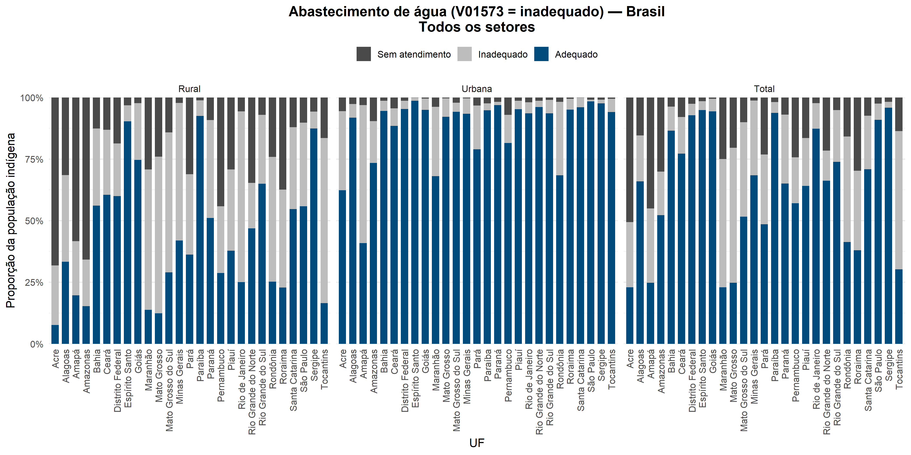
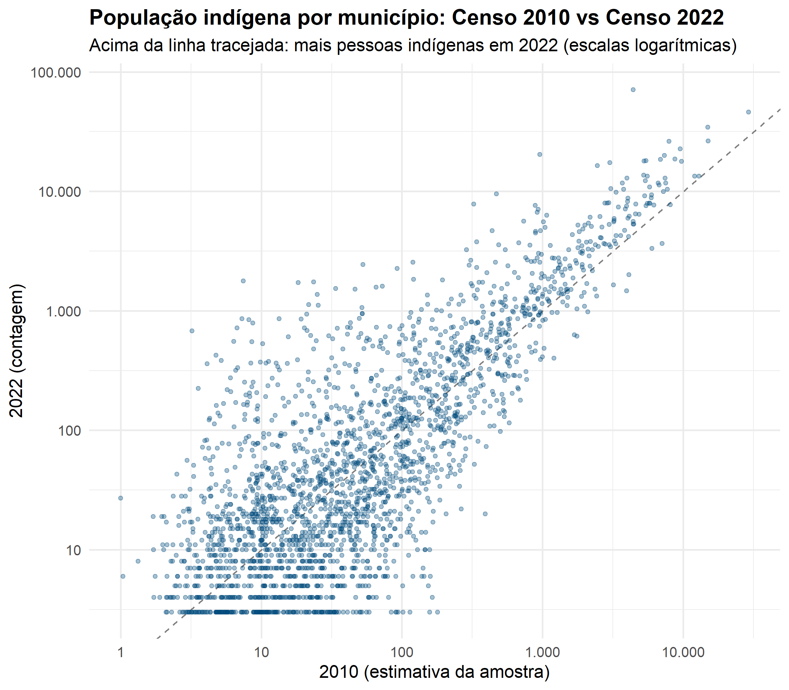

# Water, sanitation and waste for Indigenous peoples in Brazil

A reproducible R pipeline that builds **water supply, sewage and solid-waste indicators
for Indigenous residents** from Brazil's **2022 Census**, with the **2010 Census** for
comparison. It uses only open IBGE data, which the code downloads itself.




## Why

Indigenous peoples in Brazil have far less access to safe water and sanitation than the
rest of the population, and the 2022 Census is the first to publish detailed
sector-level results for them. Such indicators are only as good as the way they are
defined. This pipeline makes every definition explicit and reports how much the
results change under alternative definitions.

## Run it

1. Download or clone this repository.
2. Open `indigenous-wash-census-brazil.Rproj` in RStudio.
3. Run `source("run_all.R")`.

The first run downloads about 40 MB of 2022 sector aggregates from the
[IBGE FTP](https://ftp.ibge.gov.br/Censos/Censo_Demografico_2022/Agregados_por_Setores_Censitarios/)
and the 2010 microdata through [`censobr`](https://ipeagit.github.io/censobr/).
Later runs reuse the downloaded files. Results appear in `output/`.

| Script | What it does |
|---|---|
| `scripts/01_census2022_sectors.R` | Downloads the 2022 Indigenous household and person aggregates and joins sector geography and type |
| `scripts/02_indicators_2022.R` | Tables for Brazil, region, state and municipality, plus a sensitivity analysis of the water definition |
| `scripts/03_figures_2022.R` | Access by state, for each indicator and sector type |
| `scripts/04_population_2022.R` | Indigenous population by municipality; age–sex pyramid |
| `scripts/05_census2010.R` | 2010 Indigenous population and water access from the sample microdata (weighted) |
| `scripts/06_change_2010_2022.R` | Municipal change in the Indigenous population, 2010–2022 |

## How it is organised

```
R/definitions.R   which census variables form each category (adequate / inadequate / no service)
R/functions.R     classification, summaries, charts
R/ibge.R          finds, downloads and reads IBGE files
R/paths.R         all paths relative to the project (override with DATA_DIR / OUTPUT_DIR)
scripts/          the analysis, step by step
tests/            end-to-end test on a small fake dataset in IBGE format
```

## Notes on measurement

- **Definitions are choices.** For example, whether variable `V01573` counts as
  adequate or inadequate water supply is a judgement call. Both versions are in
  `R/definitions.R`, and `02_indicators_2022.R` reports how much the results move
  between them.
- **2010 vs 2022 is not a like-for-like comparison.** The 2022 Census asked
  *"você se considera indígena?"* in more areas and covered more Indigenous lands.
  The Indigenous population counted rose from about 897 thousand (2010) to 1.69 million
  (2022), and part of that rise reflects a change in measurement rather than only
  demographic change. The 2010 figures are survey-weighted estimates; the 2022 figures
  are counts.
- **Suppressed values.** IBGE suppresses small counts ("X"). They are treated as
  missing and counted as 0 in sums, so totals for small areas are lower bounds.
- **Indigenous lands.** The public sector files do not say whether a sector lies inside
  an Indigenous land. Results are split by sector type instead: Indigenous settlements
  (*agrupamentos indígenas*, `CD_TIPO` 5) versus other sectors.

## Tests

```r
Rscript tests/test_pipeline.R
```

Builds a small fake dataset in IBGE's format (semicolon-separated, Latin-1, suppressed
values) and runs the 2022 scripts end to end, with no download needed.

## Author

Sávia Santos — demographer and researcher, Fiocruz Minas (Brazil).
Originally developed for the territorial diagnosis of the National Programme for
Indigenous Sanitation (PNSI); this repository is a public, open-data version.

## Licence

Code: MIT (see `LICENSE`). Data: IBGE, Censo Demográfico 2010 and 2022.
